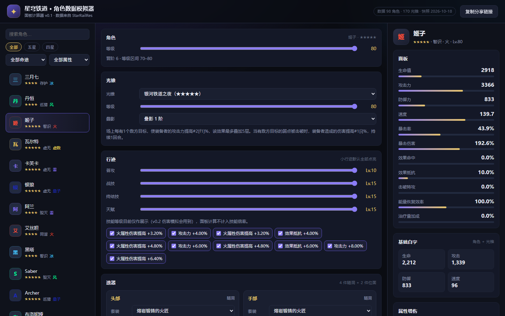

# 星穹铁道 · 角色数据模拟器

> 崩坏：星穹铁道角色**面板计算器** —— 选角色、光锥、行迹、遗器，实时算出站街面板。
> 零依赖、零构建，纯静态网页，直接 GitHub Pages 托管。



## ✨ 功能

- **98 名角色**（75 五星 / 23 四星）全量数据，支持按命途、属性、星级与关键字筛选
- **170 张光锥**，按命途自动过滤，支持等级与叠影
- 等级 1–80，自动推导晋阶阶段（0–6），基础属性按游戏公式精确计算
- 行迹：普攻 / 战技 / 终结技 / 天赋等级，小行迹可单独开关
- 遗器：4 件隧洞 + 2 件位面，主词条、副词条、强化等级（+0 ~ +15）
- 套装 2 / 4 件效果自动生效（仅无条件词条，条件效果用「手动增益」补）
- 手动增益：模拟战斗内 buff（攻击%、暴击、增伤……）
- 面板输出：生命 / 攻击 / 防御 / 速度 / 暴击率 / 暴击伤害 / 效果命中 / 效果抵抗 / 击破特攻 / 能量恢复 / 治疗加成 + 各属性增伤
- **配装分享**：状态序列化进 URL，复制链接即可分享

## 🚀 快速开始

不需要安装任何依赖，但需要通过 HTTP 访问（浏览器不允许 `file://` 下 fetch 本地 JSON）：

```bash
# 任选一种
python -m http.server 8000
# 或
npx serve .
```

然后打开 <http://localhost:8000/>。

> 部署到 GitHub Pages 后直接访问 Pages 地址即可，无需本地启动。

## 📁 目录结构

```text
.
├─ index.html               # 单页入口
├─ assets/style.css         # 深色主题样式
├─ src/
│  ├─ main.js               # 状态管理 + 渲染 + 事件
│  └─ core/
│     ├─ constants.js       # 属性映射、晋阶规则、遗器槽位
│     ├─ data.js            # 数据加载与索引
│     └─ stats.js           # 面板合成（纯函数，可单测）
├─ data/                    # 数据快照（由 scripts/sync-data.mjs 生成）
├─ scripts/sync-data.mjs    # 从 StarRailRes 拉取并裁剪数据
├─ tests/                   # 单元测试 + jsdom 冒烟测试
└─ docs/
   ├─ DESIGN.md             # 设计与公式分析
   └─ preview.png           # 界面截图
```

## 🧮 计算口径

基础属性（已用游戏权威数值交叉验证）：

```text
stat(L, p) = values[p].base + values[p].step × (L − 1)
```

- `p` 为晋阶阶段，等级区间：`1–20 / 20–30 / … / 70–80`
- 面板：`生命 = (角色 + 光锥) × (1 + Σ生命%) + Σ生命平值`，攻击、防御同理
- 速度只吃角色基础速度；暴击率基准 5%、暴击伤害基准 50%
- 遗器主词条：`base + step × 强化等级`

详细公式推导见 [docs/DESIGN.md](docs/DESIGN.md)。

## 🛠 开发

```bash
npm install          # 仅安装 jsdom（测试用），页面本身零依赖
npm test             # 运行全部测试（16 个用例）
npm run sync         # 重新拉取并生成 data/ 快照
```

需要代理时（例如本机）：

```powershell
$env:HTTPS_PROXY="http://127.0.0.1:10808"
$env:NODE_USE_ENV_PROXY="1"
npm run sync
```

## 📊 数据来源

| 项目 | 说明 |
| --- | --- |
| 数据源 | [Mar-7th/StarRailRes](https://github.com/Mar-7th/StarRailRes) |
| 许可证 | **AGPL-3.0** |
| 快照 | 见 `data/version.json`（含生成时间与数量统计） |
| 内容 | 角色/光锥/遗器等**纯文本数值**，不含任何游戏美术资源 |

数据随仓库提交，clone 下来即可离线使用；版本更新时运行 `npm run sync` 刷新。

## ⚠️ 免责声明

- 本项目为个人学习与工具用途，**不商用**。
- 游戏《崩坏：星穹铁道》及其角色、数值等内容版权归 **miHoYo** 所有。
- 条件型加成（如「对负面状态敌人增伤」）、角色专属机制无法自动判定，计算结果以游戏内实际为准。

## 📄 License

[AGPL-3.0](LICENSE)

## 🗺 路线图

- [x] v0.1 数据管道 + 面板计算器
- [ ] v0.2 伤害模拟（技能倍率、敌方抗性/防御/韧性）
- [ ] v0.3 遗器副词条收益排行、配装对比
- [ ] v0.4 移动端优化、多语言
